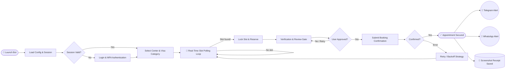
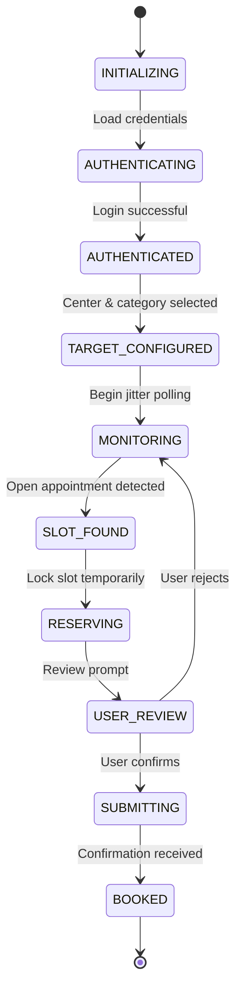

<div align="center">


<br/>


<br/><br/>


<br/><br/>


</div>

---

<div align="center">

## 🧭 What is TLS Contact France UK AutoBot?

</div>

**TLS Contact France UK AutoBot** is an advanced appointment automation engine specifically engineered to monitor the official **TLS Contact (United Kingdom to France)** visa appointment portal around the clock — identifying open slots the second they drop and securing your booking seamlessly.

It manages the end-to-end appointment lifecycle: secure authentication, VAC center selection, visa category targeting, real-time slot polling, identity verification, through to final booking submission — with interactive **human-in-the-loop review checkpoints**.

> 📡 The instant an appointment slot opens, instant alerts are dispatched to **Telegram and WhatsApp** — zero manual refreshing, zero missed opportunities.

---

<br/>

## ⚡ Core Features

<div align="center">

| | Feature | Description |
|:---:|---|---|
| 🟢 | **Auto Booking Engine** | Monitors TLS Contact United Kingdom portal 24/7 and locks open slots within milliseconds of release. |
| 🏙️ | **Multi-Center Support** | Full coverage for all authorized application centers across United Kingdom. |
| 🗂️ | **Comprehensive Visa Types** | Supports Tourist, Business, Student, Family Visit, and Work categories. |
| 🔐 | **Session Persistence** | Secure state & cookie caching — minimizes repeated logins and re-authentication hurdles. |
| 🤳 | **Verification Gate** | Interactive verification handling with live user approval before submission. |
| 🔁 | **Anti-Ban Jitter Polling** | Randomized polling intervals with exponential backoff — prevents portal bans and rate limits. |
| 🔔 | **Instant Dual Alerts** | Real-time notifications via Telegram & WhatsApp upon slot detection and booking updates. |
| 🧱 | **State Machine Flow** | Deterministic state transitions with automated error handling and recovery mechanisms. |
| 📸 | **Audit Logging & Receipts** | Auto-captures confirmation screenshots and stores timestamped audit logs. |
| ⚙️ | **Isolated Configuration** | Credentials and personal preferences stay local inside `.env` — never pushed to git. |

</div>

<br/>

---

## 🗺️ How It Works



<br/>



<br/>

---

## 📍 Supported Application Centers

- **London**
- **Manchester**
- **Edinburgh**

<br/>

---

## 📂 Supported Visa Categories

- Tourism
- Business
- Family Visit
- Student

<br/>

---

## 🏗️ Project Architecture

```
uk_tls_bot/
│
├── 📄 README.md                    ← Complete documentation and guide
├── 📄 config.ts                    ← Route definitions, login URLs, centers & categories
├── 📄 index.ts                     ← Main automation lifecycle and runner
├── 📄 package.json                 ← Node.js / TypeScript dependencies & scripts
├── 📄 tsconfig.json                ← TypeScript compiler settings
├── 📁 src/                         ← Core automation engine
│   ├── browser.ts                  ← Playwright stealth context & cookie persistence
│   ├── bot.ts                      ← Monitoring loop & slot reservation logic
│   └── notifications.ts            ← Telegram Bot API & WhatsApp notification client
├── 📁 logs/                        ← Execution logs (auto-generated)
└── 📁 receipts/                    ← Booking screenshots and confirmation receipts
```

<br/>

---

## 🖥️ Tech Stack

<div align="center">


</div>

<br/>

---

## 🚀 Getting Started

### 1. Prerequisites
- **Node.js**: v18.0.0 or higher
- **npm** or **pnpm** / **yarn**
- Valid account credentials for **TLS Contact (United Kingdom)**
- Official Portal URL: [https://visas-fr.tlscontact.com/en-us/login](https://visas-fr.tlscontact.com/en-us/login)

### 2. Installation

```bash
# Navigate to the project directory
cd "uk_tls_bot"

# Install project dependencies
npm install

# Install Playwright browser binaries
npx playwright install chromium
```

### 3. Configuration

Create your `.env` configuration file in the project root:

```bash
# Copy example configuration
copy .env.example .env
```

Edit `.env` with your credentials and preferences:

```env
# Portal Credentials
PORTAL_URL=https://visas-fr.tlscontact.com/en-us/login
USER_EMAIL=your_email@example.com
USER_PASSWORD=your_secure_password

# Target Preferences
PREFERRED_CENTER=London
VISA_CATEGORY=Tourism

# Monitoring Interval (Seconds)
POLL_INTERVAL_MIN=30
POLL_INTERVAL_MAX=60

# Instant Alerts
TELEGRAM_BOT_TOKEN=your_telegram_bot_token
TELEGRAM_CHAT_ID=your_telegram_chat_id
WHATSAPP_PHONE=201200655872
```

### 4. Running the Bot

```bash
# Start bot in development mode (with auto-reload)
npm run dev

# Or compile and run in production mode
npm run build
npm start
```

<br/>

---

## 🔔 Notification Setup

<details>
<summary><b>📨 Telegram Alerts — Step-by-Step Guide</b></summary>
<br/>

1. Open Telegram and search for **[@BotFather](https://t.me/BotFather)**.
2. Send `/newbot` and follow the instructions to generate your **Bot Token**.
3. Send a message to your newly created bot.
4. Obtain your **Chat ID** from **[@userinfobot](https://t.me/userinfobot)**.
5. Populate `TELEGRAM_BOT_TOKEN` and `TELEGRAM_CHAT_ID` inside your `.env`.

</details>

<details>
<summary><b>📱 WhatsApp Alerts — Step-by-Step Guide</b></summary>
<br/>

WhatsApp notifications run directly through our high-speed notification gateway.  
Click the WhatsApp button below to get your gateway connection key and activation details.

</details>

<br/>

---

## 🛡️ Safety & Compliance

> [!IMPORTANT]
> This automation framework is designed with strict **human-in-the-loop** guardrails. It never bypasses CAPTCHA, authentication credentials, or identity verification mechanisms.

| Policy | Implementation |
|---|---|
| **Human Approval Required** | All critical reservation checkpoints require interactive confirmation |
| **Credentials Protection** | Credentials remain strictly local inside untracked `.env` files |
| **Rate-Limit Respect** | Jittered randomized intervals prevent portal flooding |
| **Session Integrity** | Uses standard browser sessions mimicking genuine applicant interaction |

<br/>

---

## ⚠️ Disclaimer

This tool is designed exclusively for personal assistance in booking official visa appointments. Users are strictly responsible for complying with the terms of service of **TLS Contact** and local regulatory frameworks. The maintainers assume no responsibility for account actions, scheduling disputes, or improper utilization.

<br/>

---

## 📬 Contact & Support

<div align="center">

**Questions, custom setups, or priority integrations? Connect directly:**

<br/>

<a href="https://wa.me/201200655872" target="_blank">
  
</a>
&nbsp;&nbsp;
<a href="https://t.me/iqrouter" target="_blank">
  
</a>

<br/><br/>

<sub>Response time: typically within a few hours · 24/7 dedicated support</sub>

</div>

<br/>

---

<div align="center">


<sub>Built with ⚙️ precision automation, ☕ dedication, and resilience.</sub>

<br/>


</div>
